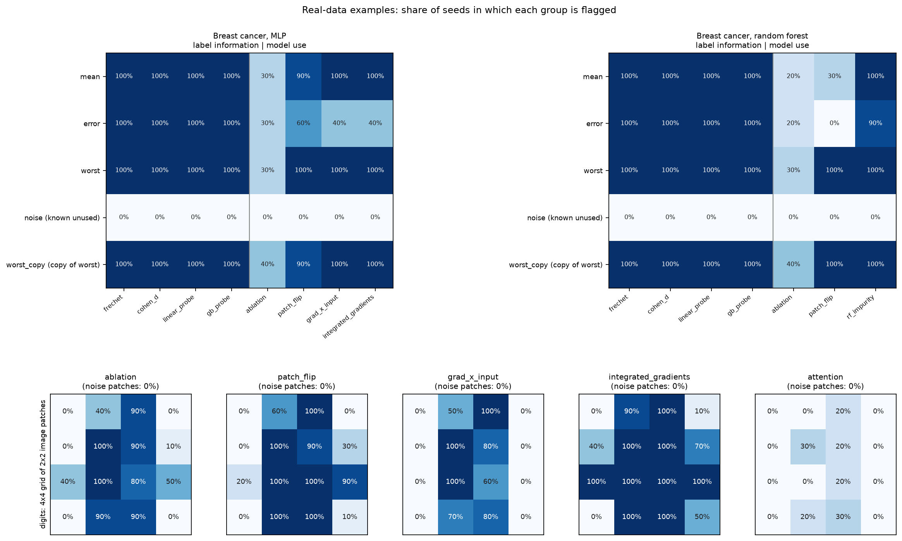

# triframe

**Which groups of input features does a trained model actually rely on, and
can you show it?**

triframe answers this for models whose inputs form named feature groups. In
genomics these are things like non-B DNA motifs, repeat-element composition,
RNA secondary structure, chromatin marks or conservation scores. You tell
triframe how your features are grouped; it tests each group, alone and in
combination, at three levels of evidence.

## What it does

Attention weights and SHAP-style scores show what a model *looks at*, not what
it *needs*. A group can get high attention and be irrelevant, or be essential
without predicting the label on its own (for example a group that cancels noise
in another). triframe puts three kinds of evidence side by side:

| Question | Evidence | Needs the model? |
|----------|----------|------------------|
| Does the model's own behaviour point to this group? | **Layer 1, diagnostics**: attention, removing the group and re-scoring | Yes |
| Does this group differ between classes (e.g. lncRNA vs mRNA)? | **Layer 2, associational**: distance between class distributions, effect sizes | No |
| Does changing this group change the model's decision? | **Layer 3, interventional**: copy the group's values from one transcript into another and see if the prediction follows | Yes |

- **Layer 2 high, Layer 3 high:** the group carries label information and the
  model uses it.
- **Layer 2 high, Layer 3 low:** the group is informative, but the model does
  not rely on it (another group covers for it, say).
- **Layer 2 low, Layer 3 high:** the model uses the group although it does not
  separate the classes alone (a noise suppressor, or an interaction), or it
  uses a shortcut such as a zero or missing-value pattern that tracks the
  label. Run `triframe.audit.label_association_screen` on the group's
  features before reading it as biology.

**Which layer do I need?** No trained model yet: Layer 2. A trained model: add
Layers 1 and 3. Layer 3 is the only one that tests what the model needs.

## Install

```bash
git clone https://github.com/cbib/triframe.git
cd triframe
pip install -e .            # add ".[dev]" for pytest
```

Python 3.9+, PyTorch, numpy, pandas, scipy, scikit-learn, matplotlib.

## Two-minute example (no data needed)

```python
from triframe.examples.beta_vae_subgroup_minimal.synthetic_data import build_registry, generate
from triframe.layer2 import frechet_by_token

registry = build_registry()                  # 9 feature groups in 3 blocks
data = generate(n=2000, seed=0)
block_data = {b: data[b] for b in registry.block_names}
print(frechet_by_token(registry, block_data, data["labels"]))
# one row per group: strong_signal ranks first, noise groups are near zero
```

This step needs no model. For all three layers end to end on a trained model,
run `python -m triframe.examples.quickstart`.

## Use it on your own model

**1. Describe your feature groups.** List each input feature with its block
(data source) and group (subgroup).

```python
from triframe import TokenRegistry, BlockMeta, FeatureMeta

registry = TokenRegistry(blocks={
    "nonb": (BlockMeta("nonb", description="non-B DNA motifs"),
             [FeatureMeta("gq_count", "nonb", "GQ", category="count"),
              FeatureMeta("ir_count", "nonb", "IR", category="count")]),
    "rep":  (BlockMeta("rep", description="repeat elements"),
             [FeatureMeta("alu_frac", "rep", "REP_CORE", category="continuous")]),
})
```

**2. Connect your model with a short adapter.** Choose the route that fits:

- *Any model with a prediction function* (an MLP, a random forest, anything
  scikit-learn style). Treat input column groups as the groups and substitute
  those columns when patching. This is the easiest route, and
  `triframe/examples/breast_cancer.py` has a complete template.

  ```python
  from triframe import ModelAdapter

  class MyAdapter(ModelAdapter):
      differentiable = False                       # True for PyTorch models
      def run_forward(self, batch): ...            # batch["x"]: (samples, features)
      def get_output_value(self, out): ...         # class scores
      def capture_tokens(self, batch): ...         # (samples, groups, group size)
      def run_forward_patched(self, batch, positions, values): ...  # replace those columns
  ```

- *A PyTorch model that already builds one vector per feature group.* Return
  that module from `get_token_module()` and implement `run_forward` and
  `get_output_value`; patching and capture come for free.

**3. Run the layers** you need. Every function, with code, is in
[`docs/reference.md`](docs/reference.md).

## What you get

Controlled scenarios with known answers, and three real-data examples (breast
cancer with a plain MLP and a random forest; digits with a small transformer),
show where the layers agree and where they do not. For example, on the digits
data the four corner patches carry label information together (AUC 0.87), yet
replacing them barely changes predictions; the four centre patches are the ones
the model uses.



Tests, results and every command to reproduce them are in
[`docs/validation.md`](docs/validation.md).

## Glossary

- **Feature group** (called a *token* in the code): a set of input features
  treated as one unit, for example all non-B motif counts.
- **Block**: features that come from one data source; a block holds several
  groups.
- **Adapter**: a few lines telling triframe how to run your model and read its
  prediction.
- **Patching / interchange intervention**: replacing a group's values in one
  sample with another sample's, then re-running the model.
- **IIA (interchange intervention accuracy)**: how often a patched prediction
  follows the sample the values came from.
- **Fréchet distance**: distance between two classes' distributions, through
  means and covariances.

## Limitations

- Groups are analysed as units of equal size, so groups of different size need
  padding in the adapter.
- Interventions act on the model's inputs or learned group representations,
  not on the biology. Results say what the model uses, not what the cell uses.
- Alpha release (v0.1); the API may change.

## Origin, development, citation

triframe is the domain-independent core of the analysis in a lncRNA/mRNA
classifier (β-LNC, manuscript in preparation).

```bash
pip install -e ".[dev]" && pytest tests/ -v
```

Citation details will be added with the manuscript. Released under the MIT
licence (see `LICENSE`).